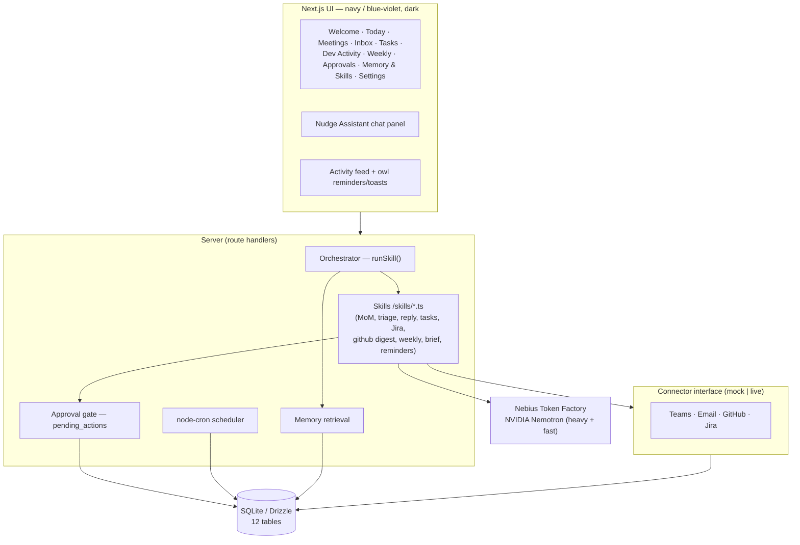

# Nudge 🦉

> **Your work, handled. Gently.**

Nudge is a **private, always-on AI office buddy**. It connects to Teams, Email, GitHub
and Jira and quietly takes over the daily admin — tracking meetings, writing minutes
(MoMs), drafting email replies, building your to-do list, drafting Jira comments,
reminding you about timesheets, and compiling your weekly update.

**Nudge never sends or changes anything without your approval.** Every outward action
is queued and waits for your OK.

Every AI task runs through **NVIDIA Nemotron** models on the **Nebius Token Factory**.

---

## ✨ What Nudge does

| Area | What it does |
|------|--------------|
| **Today** | An AI morning brief, your meetings, prioritised tasks, an "approvals needed" counter, an amber "Nudge says…" callout, and a live "what Nudge did today" activity feed. |
| **Meetings** | One click turns a transcript into minutes: summary, decisions, discussion, and action items you can push straight to your task list. |
| **Inbox** | Triages email into Urgent / Needs reply / FYI, drafts replies in your tone, and auto-creates a task from urgent mail. Approve, edit, regenerate or reject. |
| **Tasks** | One to-do list pulled from meetings, email and Jira, with source badges, filters and drag-to-reorder. |
| **Dev Activity** | Turns today's commits & PRs into a plain-language summary, shows a Jira board, and drafts closing comments + status transitions for finished work. |
| **Weekly Update** | Compiles the week into Highlights / Progress / Blockers / Next week — editable, per-section regenerate, export to Markdown. |
| **Approvals Center** | A single queue of everything awaiting your OK (replies, Jira comments, ticket moves), with bulk approve. |
| **Memory & Skills** | See and edit what Nudge remembers (people, projects, preferences, writing style) and toggle its skills on/off. |
| **Settings & Privacy** | Per-tool permissions (read / read+draft / act-with-approval), Demo↔Live toggle, reminder schedule, data export and delete-all. |
| **Reminders** | A friendly owl bell for timesheets, end-of-day and the Friday report. |

---

## 🚀 Quick start (demo mode)

Demo mode shows a full, believable workday with **zero credentials except a Nebius key**.

```bash
# 1. Install
npm install

# 2. Set up the database + seed the demo workday
npm run setup            # = drizzle-kit push + seed

# 3. Add your Nebius key (only thing needed for AI)
cp .env.example .env
#   → open .env and paste your key after NEBIUS_API_KEY=

# 4. Confirm your Nemotron model IDs (optional but recommended)
npm run models           # lists the models your account can use

# 5. Run
npm run dev              # http://localhost:3000
```

The **Welcome page** explains everything in ~10 seconds. Click **"Try with demo data"**
to land on Today. The database and all your data live locally in `nudge.db`.

> Without a Nebius key, the whole UI still works on seeded data — only the AI actions
> (MoM, triage, drafts, brief, weekly update) need the key.

### Scripts

| Script | What it does |
|--------|--------------|
| `npm run dev` | Start the dev server |
| `npm run build` / `npm start` | Production build / serve |
| `npm run db:push` | Create/update the SQLite schema |
| `npm run seed` | Reset to a clean demo workday |
| `npm run setup` | `db:push` + `seed` |
| `npm run models` | List the Nemotron models available to your Nebius account |

---

## 🔑 Environment variables

Only `NEBIUS_API_KEY` is required for the demo. See [`.env.example`](.env.example).

| Variable | Required | Purpose |
|----------|----------|---------|
| `NEBIUS_API_KEY` | ✅ | Auth for Nebius Token Factory |
| `NEBIUS_BASE_URL` | – | OpenAI-compatible base URL (default `https://api.tokenfactory.nebius.com/v1/`) |
| `MODEL_HEAVY` | – | Stronger Nemotron for reasoning (default `nvidia/nemotron-3-super-120b-a12b`) |
| `MODEL_FAST` | – | Smaller Nemotron for triage/reminders |
| `DATABASE_URL` | – | SQLite file (default `file:./nudge.db`) |
| `GITHUB_TOKEN`, `JIRA_*`, `MS_GRAPH_*` | – | Live connectors (optional; demo ignores them) |

---

## 🧠 How we use Nemotron + Nebius Token Factory

Nudge talks to **Nebius Token Factory** through its **OpenAI-compatible API** using the
official OpenAI SDK pointed at `NEBIUS_BASE_URL`
(`https://api.tokenfactory.nebius.com/v1/`). Every model call is an **NVIDIA Nemotron**
model.

**Two tiers (configurable via env):**

- **`MODEL_HEAVY` — `nvidia/nemotron-3-super-120b-a12b`** does the heavy reasoning:
  meeting minutes, email reply drafting, the morning brief, the weekly update, and Jira
  closing comments.
- **`MODEL_FAST`** — a smaller/faster Nemotron — does the quick, high-volume work: inbox
  triage, task extraction, Jira update suggestions and reminder copy.

**How a call works** (`src/ai/client.ts`, `src/ai/orchestrator.ts`):

1. A **skill** (`src/skills/*.ts`) defines a system prompt, the model tier, and a **Zod
   output schema**.
2. The **orchestrator** checks the skill is enabled, retrieves relevant **memories**
   (people, projects, writing style) and injects them into the prompt.
3. `completeJSON()` calls the Nemotron model, strips any reasoning/markdown, parses the
   JSON and **validates it against the Zod schema**, retrying once on malformed output.
4. Outward actions are never executed by the model — they're written to `pending_actions`
   and only run after you approve them.

> We do not hardcode or guess model IDs or the base URL — they come from env, and
> `npm run models` lists exactly what your account supports. Confirm `MODEL_FAST` with it.

---

## 🏗️ Architecture



**The golden rule, enforced in code:** send email, post Jira comment, transition ticket
and create timesheet entries are all written as `pending_actions` and only executed by
`approveAction()` after you say OK — then logged to the activity feed.

---

## 🎯 Personal-AI track, made visible

| Requirement | Where you see it |
|-------------|------------------|
| **Persistent memory** | Memory & Skills page — editable cards; injected into every prompt; learns your style from edited drafts |
| **Reusable skills** | Memory & Skills page — toggle each skill on/off; modular `src/skills/*.ts` |
| **User-chosen tool access** | Welcome + Settings — per-tool read / read+draft / act-with-approval |
| **Privacy / user control** | Approval gate everywhere; Settings privacy statement; export & delete-all |
| **Background tasks** | Scheduler + reminder bell; "What Nudge did today" activity feed |

---

## 📁 Project structure

```
src/
  app/(app)/        pages (today, meetings, inbox, tasks, dev, weekly, approvals, memory, settings)
  app/api/          route handlers (skills, approvals, tasks, settings, scheduler, notifications)
  ai/               Nebius client, orchestrator, memory, approval gate
  skills/           modular skills (system prompt + Zod schema per skill)
  connectors/       Connector interface + mock implementations (live-ready)
  components/        UI (owl logo, layout, per-page components, notifications)
  db/               Drizzle schema, client, seed
  scheduler/        node-cron reminders
```

## 🛠️ Tech

Next.js 16 (App Router) · TypeScript · Tailwind CSS v4 · Drizzle ORM + SQLite ·
OpenAI SDK → Nebius Token Factory · NVIDIA Nemotron · Zod · Framer Motion · lucide-react.

## 📄 Licence

MIT — see [LICENSE](LICENSE).

---

*Built for the hackathon. Feedback for Nebius/NVIDIA is in [FEEDBACK.md](FEEDBACK.md); a
3-minute run-through is in [DEMO_SCRIPT.md](DEMO_SCRIPT.md).*
