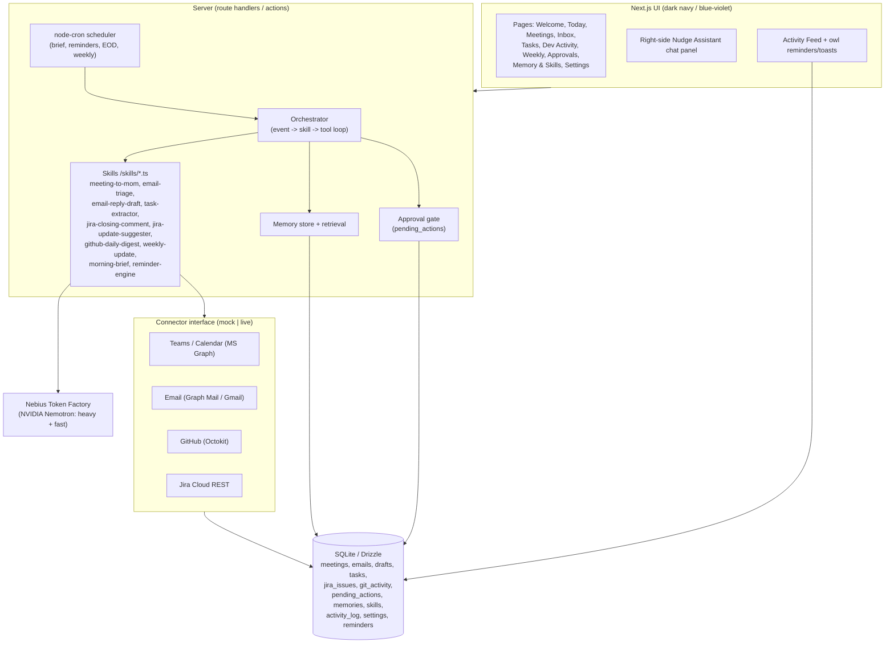

# Nudge — Master Plan & PR Index

> *"Your work, handled. Gently."*
> Nudge is an always-on, private AI office buddy. It watches Teams/Email/GitHub/Jira,
> drafts the admin work (MoMs, replies, tasks, Jira comments, weekly update), and
> **never sends or changes anything without the user's approval.**

This folder is the build plan. Each `NN-*.md` file is one PR / feature slice with its
own goal, scope, files, and acceptance criteria. Build them roughly in order; commit
after each one (per spec §8).

---

## 1. Hackathon framing (read first)

This is an **MVP for a hackathon**. That changes priorities:

- **The demo is the product.** Everything is judged on a 3-minute run. Demo mode with
  seeded data must be flawless and work with *only* a Nebius API key.
- **Live connectors are a stretch goal**, not MVP. Mock connectors behind the
  `Connector` interface are what we actually ship and demo.
- **Depth over breadth** on the hero flow: *urgent email → triage → drafted reply →
  approve → urgent task created → logged in activity feed.* If only one thing is
  perfect, it's this.
- Prefer finishing a vertical slice (UI + agent + DB) over half-building many pages.

### Priority tiers

| Tier | Meaning | PRs |
|------|---------|-----|
| **P0 — Demo critical** | Must work for the video. No demo without these. | 01, 02, 03, 04, 05 |
| **P1 — Core** | Rounds out the product story; high judging value. | 06, 07, 08, 09, 10, 13 |
| **P2 — Stretch** | Only if time remains. | 11, and the bonus Nebius Serverless deploy |
| **P-continuous** | 12 (polish) is applied continuously, finalised at the end. |

**If time runs out, ship: 01 → 02 → 03 → 04 → 05 → 13.** That is a complete,
self-explanatory, demoable product.

---

## 2. Personal-AI track requirements → where they live

The track wants five things visible in the UI. Mapping so we never lose them:

| Requirement | Where it's visible | PR |
|---|---|---|
| **Persistent memory** | Memory & Skills page (editable cards); injected into prompts | 09, 03 |
| **Reusable skills** | Skills list (toggle on/off); `/skills/*.ts` modules | 09, 03 |
| **User-chosen tool access** | Onboarding + Settings per-tool permission toggles (read / read+draft / act-with-approval) | 01, 10 |
| **Privacy / user control** | Approval gate everywhere; Settings privacy statement; delete-all-data | 04, 10 |
| **Background tasks** | Scheduler (morning brief, reminders, EOD, weekly); Activity Feed | 08, 05 |

Judges should *see* each of these. If a feature isn't visible in the UI, it doesn't count.

---

## 3. Tech stack (decisions locked)

- **Framework:** Next.js (App Router) + TypeScript + Tailwind + shadcn/ui + lucide-react + Framer Motion (subtle only).
- **DB:** SQLite via Drizzle ORM. Single local file (`nudge.db`). No external DB service for MVP.
- **Agent layer:** server-side TypeScript, OpenAI SDK pointed at **Nebius Token Factory** (OpenAI-compatible), tool/function calling.
- **Models:** at least one **NVIDIA Nemotron**. Heavy model for reasoning (MoM, weekly, email drafts), fast model for triage/classification/reminders. Both configurable via env.
  - ⚠️ **Do not guess the Nebius base URL or Nemotron model IDs.** Read the current Nebius Token Factory docs during PR-03 and record the exact values in `.env.example` + README.
- **Scheduler:** `node-cron` worker for background jobs.
- **Integrations:** common `Connector` interface (`listItems()`, `getItem()`, `performAction()`). Mock implementations first; live ones are stretch.
- **Validation:** Zod schemas for all structured LLM output; retry once on invalid JSON.

### Env vars (canonical list — keep `.env.example` in sync)

```
NEBIUS_API_KEY=         # the ONLY required var for demo mode
NEBIUS_BASE_URL=        # from Nebius Token Factory docs (do not guess)
MODEL_HEAVY=            # stronger Nemotron (reasoning)
MODEL_FAST=             # smaller/faster Nemotron (triage/reminders)
DATABASE_URL=file:./nudge.db
# Live connectors (all optional; demo mode ignores them)
MS_GRAPH_CLIENT_ID=
MS_GRAPH_CLIENT_SECRET=
MS_GRAPH_TENANT_ID=
GITHUB_TOKEN=
JIRA_BASE_URL=
JIRA_EMAIL=
JIRA_API_TOKEN=
```

---

## 4. Architecture



**Golden rule (enforced in code, not just UI):** every outward action — send email, post
Jira comment, transition ticket, create timesheet entry — is written as a `pending_actions`
row and only executed after explicit user approval, then logged in `activity_log`.

---

## 5. Data model (Drizzle) — single source of truth

Defined in PR-02, used everywhere after:

`meetings`, `emails`, `drafts`, `tasks`, `jira_issues`, `git_activity`,
`pending_actions`, `memories`, `skills`, `activity_log`, `settings`, `reminders`.

---

## 6. PR index

| # | PR | Tier | Depends on | File |
|---|----|------|-----------|------|
| 01 | Scaffold, design system, owl logo, layout, Welcome | P0 | — | [01-scaffold-design-system.md](01-scaffold-design-system.md) |
| 02 | DB schema, seed data, mock connectors | P0 | 01 | [02-database-demo-data.md](02-database-demo-data.md) |
| 03 | Nebius client + Meeting→MoM skill (first E2E) | P0 | 02 | [03-nebius-client-mom-skill.md](03-nebius-client-mom-skill.md) |
| 04 | Email triage + reply draft + Approvals Center (hero flow) | P0 | 03 | [04-email-triage-approvals.md](04-email-triage-approvals.md) |
| 05 | Today dashboard + Morning Brief + Tasks | P0 | 04 | [05-today-dashboard-tasks.md](05-today-dashboard-tasks.md) |
| 06 | Dev Activity (GitHub digest + Jira comments/updates) | P1 | 03 | [06-dev-activity.md](06-dev-activity.md) |
| 07 | Weekly Update generator + export | P1 | 05, 06 | [07-weekly-update.md](07-weekly-update.md) |
| 08 | Scheduler + reminders + notifications | P1 | 05 | [08-scheduler-reminders.md](08-scheduler-reminders.md) |
| 09 | Memory & Skills page | P1 | 03 | [09-memory-skills.md](09-memory-skills.md) |
| 10 | Settings & Privacy | P1 | 02 | [10-settings-privacy.md](10-settings-privacy.md) |
| 11 | Live connectors (GitHub/Jira → email → Teams) | P2 | 06, 04 | [11-live-connectors.md](11-live-connectors.md) |
| 12 | Polish (empty/loading/error states, a11y, responsive) | continuous | all | [12-polish.md](12-polish.md) |
| 13 | README, diagram, LICENSE, FEEDBACK, .env.example, DEMO_SCRIPT | P1 | all | [13-docs-license.md](13-docs-license.md) |

---

## 7. Suggested milestones

- **M1 — "It runs and looks like Nudge":** PR-01, 02. Welcome + Today shells, seeded DB, demo data visible.
- **M2 — "AI works end to end":** PR-03, 04. Real Nemotron call produces a MoM; hero email flow approves → task + log.
- **M3 — "Full day story":** PR-05, 06, 07. Dashboard, dev activity, weekly update all draw from seeded data.
- **M4 — "Personal-AI track boxes ticked":** PR-08, 09, 10. Background tasks, memory, skills, privacy controls visible.
- **M5 — "Shippable":** PR-12, 13. Polish + docs + demo script. Record the video.
- **Stretch:** PR-11 live connectors; Nebius Serverless deploy.

---

## 8. Definition of done (hackathon)

Mirrors spec §9 acceptance criteria:

- [ ] `npm install && npm run dev` with only `NEBIUS_API_KEY` set → fully working demo on seeded data.
- [ ] A first-time viewer understands what Nudge does within 10 seconds (Welcome + Today).
- [ ] Hero flow works E2E: urgent email → triage → draft → urgent task → approve → logged.
- [ ] Meeting → MoM → action items → tasks works.
- [ ] Weekly update generated from combined sources.
- [ ] No outward action happens without approval (verified in code + UI).
- [ ] Consistent navy/blue-violet theme + owl logo; no default-looking shadcn components left.
- [ ] No secrets committed; API failures handled with friendly owl messages.
- [ ] README has "How we use Nemotron + Nebius Token Factory" + architecture diagram; MIT LICENSE; FEEDBACK.md present.
- [ ] 3-minute DEMO_SCRIPT.md written and rehearsed.

---

## 9. Conventions

- **Branch/PR per file:** `pr-01-scaffold`, `pr-02-db`, … Commit after each build step.
- **Checklists:** tick `[x]` as you go; keep these files as living status.
- **Client-facing wording:** none of this ships to clients — internal hackathon build, no review markings needed.
- **Australian English** in all copy.
